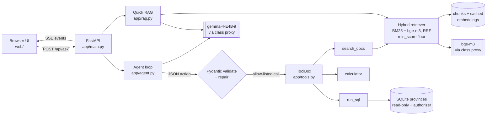

# Thai Province Agent

Ask questions about **any of Thailand's 77 provinces** and get short answers backed by citations.
The agent decides for itself whether to **search Wikipedia articles** (history, landmarks, festivals, name meanings)
or to **query a statistics table with SQL** (population, area, density, region). It can also combine the two for
multi-step questions such as *"What is the population density of the province with Thailand's largest natural lake?"*

Who it's for: students, travellers and teachers who need a quick, **checkable** fact about a Thai province.
Every answer comes with Wikipedia links or the SQL rows behind it. A plain chatbot gives confident but uncheckable
numbers instead.

> Capstone project for *Building LLM-Powered Applications* (KMITL). All model calls go through the class proxy
> (`OpenAI()`, `model="gemma-4-E4B-it"`, embeddings `bge-m3`).

## Course capability families covered

| # | Family | Where |
|---|---|---|
| 1 | **Structured output + schema validation**: every agent turn is JSON validated by a Pydantic discriminated union, with a parse → validate → repair loop | [app/structured.py](app/structured.py), [app/schemas.py](app/schemas.py) |
| 2 | **RAG with citations**: section-aware chunks, BM25 (default) or BM25 + bge-m3 hybrid (RRF) with a `min_score` floor, numbered `[n]` citations checked against what was retrieved | [app/chunking.py](app/chunking.py), [app/retrieval.py](app/retrieval.py), [app/rag.py](app/rag.py) |
| 3 | **Retrieval evaluation**: Recall@k and MRR on 43 labelled queries, BM25-only / dense-only / naive-chunking baselines, chunk-size sweep, ablation, `min_score` chosen on in-corpus vs off-corpus queries | [eval/eval_retrieval.py](eval/eval_retrieval.py), [eval/data/](eval/data/) |
| 4 | **Agent loop with tools** *(agentic)*: `search_docs`, `run_sql` and `calculator`, with an allow-list, argument validation, and stop conditions (final answer / max steps / repeated call / invalid output) | [app/agent.py](app/agent.py), [app/tools.py](app/tools.py) |
| 5 | **Text-to-SQL** *(advanced, agentic)*: model-written SQL run on a read-only connection with an authorizer, single-statement SELECT only, a row cap and a step limit | [app/sqldb.py](app/sqldb.py) |
| 6 | **Served interface**: FastAPI REST and an SSE stream that shows agent steps, SQL tables and citations live | [app/main.py](app/main.py), [web/](web/) |

## Architecture



Layering: `main.py` handles HTTP only → `agent.py` / `rag.py` hold the logic → `tools.py`, `retrieval.py` and `sqldb.py`
handle data access → `llm.py` is the **only** module that talks to a model, so tests replace it with fakes.

## Quickstart

```bash
python -m venv .venv && .venv\Scripts\activate      # macOS/Linux: source .venv/bin/activate
pip install -r requirements.txt
copy .env.example .env                               # macOS/Linux: cp; then put your course key in .env
python scripts/ingest.py                             # build SQLite table + embed chunks (cached in data/cache/)
uvicorn app.main:app --port 8000                     # open http://localhost:8000
```

The raw corpus is already committed under [data/raw/](data/raw/). To re-download it from Wikipedia, run
`python scripts/fetch_corpus.py --force`.

Without a key the server still starts in **BM25-only mode**: `/api/search` and the UI load, but `/api/ask` returns 503.

### API

| Method | Path | What it does |
|---|---|---|
| `POST` | `/api/ask` `{"question": "...", "mode": "agent" \| "rag"}` | SSE stream of events. Agent mode emits `step`, `observation` (with SQL table / sources), `error` and `answer` (with validated citations). RAG mode emits `sources`, `token`… and `done` |
| `GET` | `/api/search?q=...&k=5` | Retrieval only, for debugging the index |
| `GET` | `/api/health` | Chunk count, retriever, models, `min_score` |

## Evaluation (reproducible)

```bash
python -m pytest -q                        # 48 tests, no API key needed (fake model + embedder)
python -m eval.eval_retrieval              # retrieval metrics -> eval/results/retrieval.md
python -m eval.eval_retrieval --bm25-only  # the part that needs no key (also runs in CI)
python -m eval.eval_answers --retriever bm25  # closed-book vs RAG vs agent -> eval/results/answers.md
python -m eval.eval_answers --rescore      # re-score the saved predictions without calling the model
```

**Test sets** (written by hand from the corpus, with each label checked against the article text):
- [eval/data/retrieval_qrels.jsonl](eval/data/retrieval_qrels.jsonl): 43 in-corpus queries, each labelled with
  *(article, evidence span)*. 30 are "implicit" (the province is not named, e.g. *"Where is the highest mountain in
  Thailand?"*) and 13 are "explicit". A chunk counts as relevant if it comes from that article **and** contains the
  evidence span, so the same labels score every chunk size fairly. There are also 12 off-corpus queries, used to
  choose `min_score`.
- [eval/data/qa_gold.jsonl](eval/data/qa_gold.jsonl): 34 questions with gold answers: 14 *text* (from articles),
  11 *sql* (from the table), 7 *multi-hop* (both, sometimes with arithmetic) and 2 *unanswerable* (the correct
  behaviour is to refuse). Scoring is deterministic: the answer must contain a gold alias, or a number within
  tolerance ([eval/metrics.py](eval/metrics.py)).

**Baselines:** BM25-only and dense-only retrieval, plus naive fixed 200-word chunks (no headers, no boilerplate
removal) for retrieval. For answers, the baseline is the **closed-book** model (same model, no retrieval, no tools).
Single-shot RAG is a second baseline for the agent.

### Results

**End-to-end answers** (34 questions, gemma-4-E4B-it, temperature 0, BM25 retrieval for RAG and the agent).
"Audited" means every answer marked correct was read by hand, and the matcher's false positives were overridden, with the
reasons recorded in [eval/data/manual_audit.jsonl](eval/data/manual_audit.jsonl):

| System | Audited accuracy | Automatic | Text (14) | SQL (11) | Multi-hop (7) | Unanswerable (2) |
|---|---|---|---|---|---|---|
| closed-book (baseline) | 0.294 (10/34) | 0.294 | 4/14 | 2/11 | 2/7 | 2/2 |
| single-shot RAG | 0.500 (17/34) | 0.529 | 12/14 | 2/11 | 1/7 | 2/2 |
| **agent** | **0.941 (32/34)** | 0.971 | 12/14 | 11/11 | 7/7 | 2/2 |

Wilson 95% intervals: closed-book 0.17–0.46, RAG 0.34–0.66, agent 0.81–0.98. The agent never cited a source it hadn't
retrieved, and needed one JSON repair in 34 runs.

**Retrieval** (BM25, 43 labelled queries): the contextual chunk header is the measured improvement. Removing it drops
Recall@5 from **0.907 to 0.837** (explicit questions: 0.846 → 0.692), and a size of 120 words beats 80/200/300 on
Recall@5. Honestly reported: naive fixed 200-word chunks have a *higher* MRR (0.868 vs 0.802), while ours are better on
implicit questions (Recall@5 0.933 vs 0.867). Full tables are in [eval/results/](eval/results/).

> **Note on embeddings.** During the evaluation, the class proxy's embedding endpoint failed every request for over an
> hour (`401 … column t.tpd_limit does not exist`). The numbers above therefore use BM25, and the default `RETRIEVER=bm25`
> is what was measured. Hybrid/dense retrieval and the `min_score` sweep are implemented and unit-tested: set
> `RETRIEVER=hybrid` and run `python -m eval.eval_retrieval` once the endpoint works. The server also falls back to BM25
> automatically if embedding calls fail.

The full analysis, including failure cases, is in the [project report](report/report.pdf).

## Design choices (and why)

- **Two sources, two tools.** Narrative facts live in prose, and numbers live in a table. Retrieval is unreliable for
  "which province has the smallest area?" (no chunk contains that ranking), and SQL can't say what "Phitsanulok" means.
  The agent routes each question, and multi-hop questions use both.
- **Hybrid retrieval with RRF.** BM25 nails exact names ("Bhumibol Dam", "Khorat"). bge-m3 handles paraphrases
  ("biggest national park in the country" → *Kaeng Krachan, the largest in Thailand*). RRF fuses the *ranks*,
  because their raw scores aren't comparable.
- **Section-aware chunks with a contextual header** (`Province > Section`). Implicit questions rarely name the
  province, and a chunk in the middle of an article often doesn't either. The header puts the name back in.
- **Boilerplate removal.** A near-identical "Human achievement index" paragraph (its table was stripped) appears in
  ~74 articles, so it's detected by normalised-prefix matching and dropped.
- **`min_score` floor from data, not a guess** (hybrid mode). It's picked from the in-corpus vs off-corpus top-cosine sweep in
  `eval_retrieval.py`. Below the floor, `search_docs` returns "no relevant passages" and RAG refuses.
- **JSON-text tool protocol rather than native function calling.** The proxy ignores `response_format`, and native
  tool support for gemma through it isn't guaranteed. A Pydantic discriminated union over `action` *is* the
  allow-list: an unknown tool name can never validate, let alone run.
- **Treat model output and tool output as untrusted.** SQL goes through four layers of guards. The calculator uses
  an AST allow-list (never `eval`). Tool results are clipped and framed as data. Citations the model invents (numbers
  never retrieved) are dropped and counted.
- **temperature = 0** everywhere, so evaluation runs repeat exactly.

## Repository layout

```
app/        application code (config, llm, structured, schemas, chunking, bm25, embeddings,
            retrieval, sqldb, calculator, tools, agent, rag, main)
web/        static UI (vanilla JS, SSE over fetch)
data/raw/   committed corpus: 77 province articles (.md), provinces_table.csv, manifest.json
scripts/    fetch_corpus.py (re-download), ingest.py (build DB + embeddings)
eval/       labelled data, metrics, retrieval + answer evaluation, saved results
tests/      unit, agent-loop and API tests (fake model/embedder; run in CI)
report/     project report (report.pdf), its template and the builder that fills tables from eval/results/
```

## Limitations

- English-only retrieval: the BM25 tokenizer ignores Thai script, so Thai-language questions rely on bge-m3 alone.
- The statistics table is a single snapshot (registered population, Dec 2024). Article text sometimes quotes other
  years or metro-area figures, e.g. Bangkok's 9.1 M metro estimate vs the table's 5.46 M registered.
- Answers are scored with deterministic string and number matching, which can miss correct paraphrases ("a
  quarter" is handled with an alias, but others may not be).
- A 4B-parameter model sometimes writes wrong SQL (for example a misspelled province name). The agent sees
  "0 rows" and can retry, but it doesn't always.

## Data & licence

Province articles and the statistics table come from English Wikipedia ("Provinces of Thailand", "Regions of
Thailand" and each province's article), retrieved via the MediaWiki API, under
[CC BY-SA 4.0](https://creativecommons.org/licenses/by-sa/4.0/). Each article file records its source URL.
